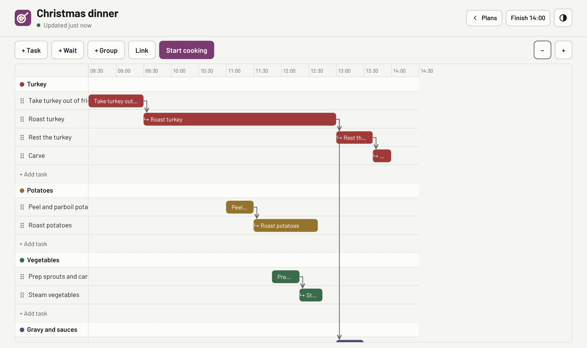

# Cooking Planner



A Gantt-style planner for timing big meals, such as Christmas dinner. Lay out each dish as tasks on a shared timeline, link the ones that depend on each other, plan forwards from a start time or backwards from when food should be on the table, then follow the plan live on cooking day. Runs self-hosted in Docker.

## Why

Big meals need several dishes, each with several steps, to finish at the same moment. A timeline with dependencies (like a project plan) makes the timing visible and does the arithmetic when something runs late. It follows my shared app standard (see [How this was built](#how-this-was-built)).

## Run it yourself

You need Docker. The app is one container with a SQLite database in a folder you choose.

> **There's no login.** Anyone who can reach the port can view, change and delete plans. Run it on your home network or behind a VPN (e.g. Tailscale), not on the open internet.

1. Make a folder for it, with a `data` folder inside, and save this as `docker-compose.yml` there:
   ```yaml
   services:
     cooking-planner:
       image: ghcr.io/nick-a-louse/cooking-planner:latest
       restart: unless-stopped
       user: "1000:1000"        # your user and group ids (run `id -u` and `id -g`)
       environment:
         TZ: Europe/London      # your time zone
       ports:
         - "3005:8000"          # change 3005 if that port is taken
       volumes:
         - ./data:/data         # the database lives here
   ```
2. Start it:
   ```bash
   docker compose up -d
   ```
3. Open http://localhost:3005, or http://&lt;that machine's address&gt;:3005 from another device.

To build the image from source instead of pulling it, clone this repo and run `docker build -t cooking-planner .`, then use `image: cooking-planner` in the compose file.

The `data` folder must be writable by the user in `user:`. Without a `user:` line the container runs as 1003:1006.

### Worked example: my home server

This is how it runs on my server: the compose file in this repo, an `.env` beside it, and the data in `/opt/appdata`.

1. Make the folders, owned by the container user (1003:1006):
   ```bash
   sudo mkdir -p /srv/cooking-planner /opt/appdata/cooking-planner
   sudo chown -R 1003:1006 /opt/appdata/cooking-planner
   ```
2. Put `docker-compose.yml` from this repo in `/srv/cooking-planner`.
3. Create `.env` from `.env.example` (there are no secrets; it sets `PUID`, `PGID` and `TZ`):
   ```bash
   cd /srv/cooking-planner
   sudo install -m 600 /dev/null .env   # then fill it in from .env.example
   ```
4. Start it:
   ```bash
   sudo docker compose pull && sudo docker compose up -d
   sudo docker compose ps     # shows "healthy" after about 20 seconds
   ```

### Updating

```bash
cd /srv/cooking-planner && sudo docker compose pull && sudo docker compose up -d
```

The database schema updates itself on start-up, and the data lives outside the container. To roll back, pin a release tag (e.g. `:1.1.0`) in `docker-compose.yml`.

### Access

- http://your-server:3005 (on your LAN, or over a VPN such as Tailscale)

No login. Mine is reachable only on the LAN and over Tailscale, not from the internet.

### Backups

The data is one SQLite database in write-ahead-logging mode, so it's **three** files: `app.db`, `app.db-wal` and `app.db-shm`. Recent changes can sit in the `-wal` file until a checkpoint, so copying `app.db` alone can lose data. Back up the folder, not the file:

```bash
tar czf cookplan-backup-$(date +%F).tar.gz -C /opt/appdata/cooking-planner .
```

To fold everything into `app.db` first, stop the container (`sudo docker compose stop`) before copying. The server's config backup already copies `/opt/appdata`.

## Configuration

Set in `.env` (see `.env.example`):

| Setting | Default | What it does |
|---|---|---|
| `PUID` / `PGID` | `1003` / `1006` | User and group the container runs as (a non-root user on the host) |
| `TZ` | `Europe/London` | Time zone for log times |
| `LOG_LEVEL` | `info` | `debug`, `info`, `warn` or `error` |

Set by the image (no need to change): `PORT=8000`, `DB_PATH=/data/app.db`, `CLIENT_DIST=/app/client/dist`, `APP_VERSION` (from the build).

## Monitoring

- `GET /healthz` returns `{"ok": true, "version": …, "plans": …, "last_save": …}`, or 503 if the database can't be read. The Docker healthcheck uses it.
- `GET /metrics` (Prometheus text, for VictoriaMetrics):
  - `cooking_planner_build_info{version}`
  - `cooking_planner_last_success_timestamp_seconds`: the most recent change to any plan
  - `cooking_planner_last_attempt_ok`: 0 if the last save failed
  - `cooking_planner_saves_total{result="ok|error"}`
  - `cooking_planner_plans{kind="plan|template"}`
  - `cooking_planner_live_streams`: plan screens currently connected for live sync
- The app is only used now and then, so there's **no "stale" alert**. A useful Grafana alert is `cooking_planner_last_attempt_ok == 0` (a save failed), plus the container being unhealthy.

The header's "Updated" line shows the last successful save. It turns red only if a save fails, never just because time has passed.

## Planning help

- **Kitchen clashes.** Set your kitchen once under **My kitchen** on the plan list (ovens and hob rings); each new plan copies it, and a plan can change its own copy in its settings. Tell each task what it **uses** (the hob, or an oven and its temperature) and the plan warns, never blocks, when two dishes need the same oven at different temperatures, or more pans need the hob than there are rings. Clashing tasks are outlined in red and listed above the timeline.
- **Hands-on overlaps.** Tasks need someone's hands unless ticked *Hands-off* (e.g. roasting); waits never do. Set how many **cooks** a plan has, and it warns when more hands-on tasks overlap than that (amber dashed outline, listed with the kitchen clashes).
- **Critical path.** The *Critical path* button outlines the chain of tasks that decides when the meal is ready (a delay to any of them makes it later) and dims the rest.
- **Print** (button in the plan header): page 1 is the whole timeline on one page, then a timed checklist with tick boxes, in time order with equipment and notes. Black on white whatever the screen theme; use the print dialog's *Save as PDF* for a file.
- **Undo and redo** (Ctrl+Z, Ctrl+Shift+Z) for up to 50 planning edits.

## On cooking day

Press **Start cooking** and the plan runs against the clock:

- **The screen stays on** while the run is live, so a phone propped up in the kitchen doesn't lock. Over HTTPS this uses the browser's [Screen Wake Lock API](https://developer.mozilla.org/en-US/docs/Web/API/Screen_Wake_Lock_API); over plain HTTP (a home network) it loops a tiny silent video instead.
- **Kitchen view**: switch a live plan from *Timeline* to *Kitchen* for large text you can read across the room: what to do now (with time left, or how late it is, and a Done button) and what's next, with countdowns. The choice is remembered per device.
- **Alerts** (a chime and a banner that stays until dismissed) when a task is coming up, should start now, should be finished, or a wait is over. Set the warning time (1, 2, 5 or 10 minutes) in plan settings. **Sound on/off** is remembered per device. Alerts work while the app is open on screen; there are no push notifications.

## Live sync

Every device with a plan open sees changes from the others straight away, whether you're planning or cooking. Each open plan keeps a [server-sent events](https://developer.mozilla.org/en-US/docs/Web/API/Server-sent_events) stream to `GET /api/plans/:id/events`, and every save is pushed to all of them.

Each save carries the plan's revision number. If two devices change the plan at the same moment, the second save is refused (409), and that device is told and shown the latest version; its clashing change is dropped. Phones that lose Wi-Fi reconnect on their own and catch up.

## Development

Needs Node 24 (Node 22.13+ works too).

```bash
npm ci
npm test                      # engine tests (shared) + server smoke tests
npm run dev                   # server on :8000 and Vite on :5173 (open http://localhost:5173)
npm run demo                  # made-up plans in the running dev server (Christmas dinner, Sunday roast, a template)
npm run demo -- http://localhost:5173   # or point it at another address
```

The logo is `client/public/static/icon.svg`, and it's also the favicon. After changing it, regenerate the icon set: `pip install cairosvg pillow && python scripts/make_icons.py --name "Cooking Planner" --short "Cooking" --accent "#7b3a72"`.

Pushing to `master` runs the tests and publishes `ghcr.io/nick-a-louse/cooking-planner:latest` (and `:sha-…`). A `v1.2.0` tag also publishes `:1.2.0`.

## Files

```
.github/workflows/build.yml   CI: test → build → push to ghcr.io
docs/screenshot.png           the picture at the top of this README
Dockerfile                    two-stage image: builds the client, runs the server as 1003:1006
docker-compose.yml            what runs on the server (/srv/cooking-planner)
.env.example                  every setting, commented
client/                       React + Vite front end
client/public/static/         gomez-ui.css/js (shared look), fonts, icon.svg + generated icons, manifest
server/                       Fastify API, /healthz, /metrics; serves the built client
shared/                       types, scheduling engine (reflow, cycles, live mode), version
scripts/demo-data.mjs         fills a running app with made-up plans
scripts/make_icons.py         builds the favicon set from icon.svg
```

## How this was built

This is one of several self-hosted apps I run at home. The code was written by Claude (an AI coding agent) under my direction. My part was the requirements, the standards, the review and the decisions:

- **Requirements first.** Functional and non-functional requirements were agreed as tickets in Obsidian before any code was written.
- **One shared standard.** All my apps share one look, one repo layout and one build-and-deploy pipeline (GitHub Actions → GitHub Container Registry → Docker Compose). `gomez-ui.css` and `gomez-ui.js` are the shared UI kit from that standard; gomez is my home server's name.
- **Reviewed before merging.** Every change came in as a pull request, with screenshots at desktop and phone widths in light and dark mode, and was merged only after I'd reviewed it and the tests passed.

More on how I work this way: [my GitHub profile](https://github.com/nick-a-louse).

## Licence

[MIT](LICENSE). Fonts are Barlow and Barlow Condensed under the SIL Open Font License (see the `OFL.txt` next to them).
